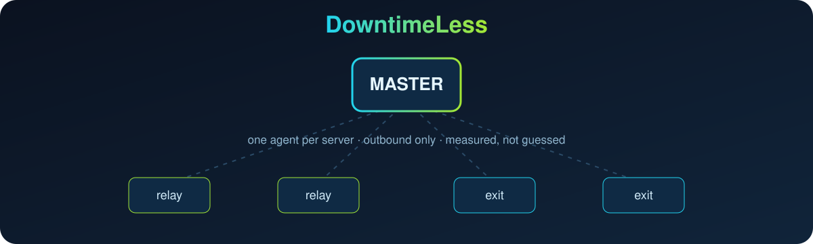

<p align="center">
  <picture>
    <source media="(prefers-color-scheme: dark)" srcset="./assets/brand/logo-dark.webp">
    
  </picture>
</p>

<p align="center">
  
</p>

<p align="center">
  مانیتور و مدیریت ناوگان VPN در یک پنل:<br>
  سرورها، رله‌ها، تونل‌ها، حجم ترافیک، failover دی‌ان‌اس و پنل‌ها، با API که ایجنت هوش مصنوعی هم می‌تواند بخواند.
</p>

<p align="center">
  
  
  
  <a href="./LICENSE"></a>
</p>

<p align="center">
  <a href="README.md">English</a> · <b>فارسی</b> · <a href="README.ru.md">Русский</a> · <a href="README.zh-CN.md">简体中文</a>
</p>

<div dir="rtl">

ناوگان VPN به شکلی خراب می‌شود که یک نقطهٔ سبز هرگز نشان نمی‌دهد: رله به ping جواب می‌دهد ولی چیزی عبور نمی‌دهد، تونل «active» است و بیکار، یا حجم تمام می‌شود و کل دیتاسنتر مرده به نظر می‌رسد. **DowntimeLess** روی هر سرور یک agent کوچک می‌گذارد، همه را از یک سرور مرکزی (master) زیر نظر می‌گیرد، در تلگرام می‌گوید چه چیزی خراب است و قدم بعدی چیست، و همین داده‌ها را به‌صورت API در اختیار ایجنت هوش مصنوعی می‌گذارد تا مشکل‌ها سریع‌تر برطرف شوند.

ایده‌های سه پروژه در آن جمع شده است: مدل مانیتورینگ [Uptime Kuma](https://github.com/louislam/uptime-kuma)، failover دی‌ان‌اس و لود بالانس وزن‌دار [cloudflare-telegram-bot](https://github.com/ExPLoSiVe1988/cloudflare-telegram-bot) و قانون‌های عملیاتیِ آزموده‌شدهٔ [VPNOpsNyx](https://github.com/nyxon-tech/vpnopsnyx).

## نصب

روی سرور مرکزی (اوبونتو یا دبیان، با root):

</div>

```sh
bash <(curl -fsSL https://raw.githubusercontent.com/Emadhabibnia1385/DowntimeLess/main/install.sh)
```

<div dir="rtl">

نصاب زیردامنهٔ پنل، توکن ربات تلگرام و حالت TLS را می‌پرسد، سرویس را پشت nginx نصب می‌کند و یک لینک یک‌بارمصرف نشان می‌دهد. آن را یک بار در تلگرام باز کنید تا مالک پنل شوید. بعد از آن با `sudo downtimeless` منو باز می‌شود.

| گزینهٔ منو | کار |
| --- | --- |
| نصب | راه‌اندازی اول: بسته‌ها، venv، سرویس systemd، سایت nginx، بررسی ربات |
| به‌روزرسانی | آخرین نسخه را می‌گیرد، ریستارت می‌کند، سلامت را می‌سنجد و در صورت خطا برمی‌گردد |
| ویرایش تنظیمات | توکن ربات، آدرس عمومی، پورت، یا باز کردن `.env` |
| وضعیت · لاگ · ریستارت | وضعیت سرویس، لاگ زنده، ریستارت همراه با بررسی سلامت |
| لینک مالک | آدرس پنل و لینک مالکِ در انتظار را نشان می‌دهد |
| بکاپ · حذف | بکاپ SQLite؛ حذفی که داده‌ها را نگه می‌دارد مگر خودتان بگویید |

سپس سرورها را از داخل پنل اضافه کنید. برای هر کدام یک دستور نشان داده می‌شود که روی همان سرور اجرا می‌کنید:

</div>

```sh
curl -fsSL https://panel.example.com/agent/install.sh | sudo bash -s -- --master https://panel.example.com --token <one-time-token>
```

<div dir="rtl">

## چه می‌کند

- **نمای ناوگان.** CPU، RAM، دیسک، steal، ارسال مجدد TCP، conntrack، uptime، آی‌پی عمومی، کشور، شهر و دیتاسنتر هر سرور.
- **ماتریس اتصال.** هر سرور به همهٔ سرورهای دیگر ping می‌گیرد؛ قطعیِ رله به خروج با درصد اتلاف و تأخیر دیده می‌شود.
- **ترافیک.** دانلود و آپلود هر سرور در بازهٔ ساعت، روز، هفته و ماه، از شمارندهٔ کارت شبکه که ریبوت را تحمل می‌کند.
- **مشکل، نه فقط عدد.** `/issues` فهرست مشکلات را با شاهد و قدم بعدی به فارسی می‌دهد.
- **تلگرام.** تأیید ورود، هشدار آفلاین‌شدن و برگشتن، و کانال لاگ توسعه‌دهنده.
- **عمل‌های ایمن.** ping، بررسی TCP و تست سرعت از هر agent. آپگرید و ریبوت فقط با سطح دسترسی هر سرور و یک انسانِ واردشده.
- **API-محور.** هرچه در پنل می‌بینید یک endpoint مستند JSON است.

مراحل بعدی به این ترتیب: دفتر حجم خریداری‌شده و هشدار «N روز مانده»، مانیتور HTTP/TCP/کلیدواژه/DNS/گواهی از چند نقطه، توکن Cloudflare با failover و لود بالانس وزن‌دار، اتصال به PasarGuard و 3x-ui و Marzban و Marzneshin و Hiddify، و اپراتور هوش مصنوعی. جزئیات در [docs/ROADMAP.md](docs/ROADMAP.md).

## چگونه کار می‌کند

</div>

```
 مرورگر / Telegram Mini App ──HTTPS──▶ nginx ──▶ master (FastAPI + SQLite، پنل وب را سرو می‌کند)
                                                   ▲
                               HTTPS، فقط خروجی    │ هر ۳۰ ثانیه: متریک + نتیجهٔ ping ⇄ jobها
                                                 agent روی هر سرور (یک فایل پایتون، فقط کتابخانهٔ استاندارد)
```

<div dir="rtl">

- agent فقط تماس خروجی می‌گیرد. هیچ کلید SSH و رمز rootی از سرور بیرون نمی‌رود.
- jobها فهرستی بسته‌اند. هر کاری که سرور را تغییر دهد، نیاز دارد سطح دسترسی همان سرور اول بالا برده شود.
- ورود با تأیید تلگرام است («خودتان بودید؟» با آی‌پی و مرورگر) و بعداً می‌توان رمز گذاشت. رازها فقط به‌صورت hash ذخیره می‌شوند.

## برای ایجنت‌های هوش مصنوعی

در پنل (مالک، کلیدهای API) یک کلید بسازید و به ایجنت بدهید:

</div>

```sh
curl -H "Authorization: Bearer dl_..." https://panel.example.com/api/v1/snapshot   # کل ناوگان + مشکلات + ماتریس اتصال
curl -H "Authorization: Bearer dl_..." https://panel.example.com/api/v1/issues     # چه چیزی خراب است، با شاهد
```

<div dir="rtl">

کلید `read` فقط می‌خواند. کلید `operate` می‌تواند بررسی‌های فقط‌خواندنی را هم در صف بگذارد. هیچ کلیدی نمی‌تواند ریبوت، آپگرید یا مدیریت کاربر و کلید انجام دهد. شِمای API در `/api/openapi.json` و توضیح ویژهٔ ایجنت‌ها در `/llms.txt` است.

## ساختار ریپو

| مسیر | محتوا |
| --- | --- |
| `master/` | بک‌اند FastAPI، SQLite، ربات تلگرام، تست‌ها |
| `agent/` | جمع‌آورنده‌ای که روی هر سرور نصب می‌شود |
| `web/` | پنل وب فارسی RTL (فایل‌های build شده commit می‌شوند) |
| `install.sh` | نصاب و مدیر master |
| `docs/` | [معماری](docs/ARCHITECTURE.md)، [نقشه راه](docs/ROADMAP.md)، [OpenAPI](docs/openapi.json) |

## توسعه‌دهنده

ساختهٔ عماد حبیب‌نیا · تلگرام [@emadhabibnia](https://t.me/emadhabibnia) · گیت‌هاب [emadhabibnia1385](https://github.com/emadhabibnia1385).

## لایسنس

[MIT](LICENSE)

</div>
