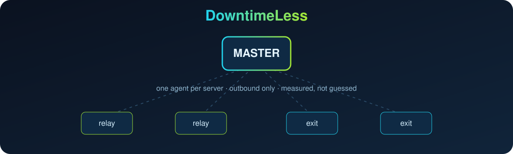

<p align="center">
  <picture>
    <source media="(prefers-color-scheme: dark)" srcset="./assets/brand/logo-dark.webp">
    
  </picture>
</p>

<p align="center">
  
</p>

<p align="center">
  Monitor and manage a VPN fleet from one panel:<br>
  servers, relays, tunnels, traffic quotas, DNS failover and panels, with an API your AI agent can read.
</p>

<p align="center">
  
  
  
  <a href="./LICENSE"></a>
</p>

<p align="center">
  <b>English</b> · <a href="README.fa.md">فارسی</a> · <a href="README.ru.md">Русский</a> · <a href="README.zh-CN.md">简体中文</a>
</p>

A VPN fleet breaks in ways a green dot never shows: a relay answers ping and carries nothing, a tunnel is "active" and idle, a quota runs out and the whole datacenter looks dead. **DowntimeLess** puts one small agent on every server, watches them all from a master, tells you in Telegram what is wrong and what to try next, and exposes the same data as a JSON API so an AI agent can fetch the problems and help fix them faster.

It combines three ideas: the monitoring model of [Uptime Kuma](https://github.com/louislam/uptime-kuma), the DNS failover and weighted load balancing of [cloudflare-telegram-bot](https://github.com/ExPLoSiVe1988/cloudflare-telegram-bot), and the field-tested operating rules of [VPNOpsNyx](https://github.com/nyxon-tech/vpnopsnyx).

## Install

On the master server (Ubuntu or Debian, root):

```sh
bash <(curl -fsSL https://raw.githubusercontent.com/Emadhabibnia1385/DowntimeLess/main/install.sh)
```

The installer asks for a panel sub-domain, a Telegram bot token and a TLS mode, installs the service behind nginx, and prints a one-time link. Open it in Telegram once and you are the owner. Afterwards run `sudo downtimeless` for the menu.

| Menu | What it does |
| --- | --- |
| Install | First setup: packages, venv, systemd service, nginx site, bot check |
| Update | Pulls the latest version, restarts, checks health and rolls back on failure |
| Edit settings | Bot token, public URL, port, or open `.env` in an editor |
| Status · Logs · Restart | Service state, live journal, restart with health check |
| Owner link | Shows the panel address and the pending owner link |
| Backup · Uninstall | SQLite backup; removal that keeps your data unless you say so |

Then add servers in the panel. Each one shows a single command to run on that server:

```sh
curl -fsSL https://panel.example.com/agent/install.sh | sudo bash -s -- --master https://panel.example.com --token <one-time-token>
```

## What it does

- **Fleet view.** CPU, RAM, disk, steal, TCP retransmits, conntrack, uptime, public IP, country, city and datacenter for every server.
- **Link matrix.** Every server pings every other one; a cut relay-to-exit link shows up with loss and latency.
- **Traffic.** Per-server download and upload by hour, day, week and month, from NIC counters that survive reboots.
- **Problems, not just numbers.** `/issues` lists what is wrong with evidence and a suggested next step in Persian.
- **Telegram.** Login approval, offline and recovery alerts, and a channel for the developer log.
- **Safe actions.** Ping, TCP checks and speed tests run from any agent. Upgrade and reboot exist only behind a per-server permission level and a signed-in human.
- **API first.** Everything in the panel is a documented JSON endpoint.

Coming next, in this order: purchased-traffic ledger with "N days left" alerts, HTTP/TCP/keyword/DNS/certificate monitors from several probe locations, Cloudflare tokens with DNS failover and weighted load balancing, PasarGuard / 3x-ui / Marzban / Marzneshin / Hiddify connectors, and an AI operator. See [docs/ROADMAP.md](docs/ROADMAP.md).

## How it works

```
 browser / Telegram Mini App ──HTTPS──▶ nginx ──▶ master (FastAPI + SQLite, serves the web panel)
                                                    ▲
                                    HTTPS, outbound │ every 30 s: metrics + ping results ⇄ jobs
                                                  agent on each server (one Python file, stdlib only)
```

- The agent only dials out. No SSH key and no root password ever leaves a server.
- Jobs are a closed list. Anything that changes a server needs that server's permission level raised first.
- Login is a Telegram approval ("was this you?" with IP and browser), with an optional password afterwards. Secrets are stored only as hashes.

## For AI agents

Create a key in the panel (owner, API keys) and give it to your agent:

```sh
curl -H "Authorization: Bearer dl_..." https://panel.example.com/api/v1/snapshot   # whole fleet + issues + link matrix
curl -H "Authorization: Bearer dl_..." https://panel.example.com/api/v1/issues     # what is wrong, with evidence
```

A `read` key can only read. An `operate` key may also queue read-only checks. No key can reboot, upgrade or manage users and keys. The schema is at `/api/openapi.json` and `/llms.txt` describes it for agents.

## Repository

| Path | What |
| --- | --- |
| `master/` | FastAPI backend, SQLite, Telegram bot, tests |
| `agent/` | The collector installed on every server |
| `web/` | The Persian RTL web panel (built files are committed) |
| `install.sh` | Master installer and manager |
| `docs/` | [Architecture](docs/ARCHITECTURE.md), [roadmap](docs/ROADMAP.md), [OpenAPI](docs/openapi.json) |

## Developer

Built by Emad Habibnia · Telegram [@emadhabibnia](https://t.me/emadhabibnia) · GitHub [emadhabibnia1385](https://github.com/emadhabibnia1385).

## License

[MIT](LICENSE)
