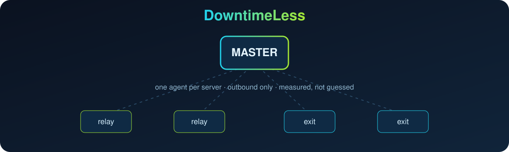

<p align="center">
  <picture>
    <source media="(prefers-color-scheme: dark)" srcset="./assets/brand/logo-dark.webp">
    
  </picture>
</p>

<p align="center">
  
</p>

<p align="center">
  Мониторинг и управление VPN-флотом в одной панели:<br>
  серверы, ретрансляторы, туннели, квоты трафика, DNS-failover и панели, с API, которое читает ваш ИИ-агент.
</p>

<p align="center">
  
  
  
  <a href="./LICENSE"></a>
</p>

<p align="center">
  <a href="README.md">English</a> · <a href="README.fa.md">فارسی</a> · <b>Русский</b> · <a href="README.zh-CN.md">简体中文</a>
</p>

VPN-флот ломается так, как зелёная точка никогда не покажет: ретранслятор отвечает на ping и ничего не передаёт, туннель «active», но простаивает, квота кончилась и весь дата-центр выглядит мёртвым. **DowntimeLess** ставит на каждый сервер маленький агент, следит за всеми из master-сервера, сообщает в Telegram, что сломано и что попробовать дальше, и отдаёт те же данные через JSON API, чтобы ИИ-агент быстрее находил и устранял проблемы.

Проект объединяет три идеи: модель мониторинга [Uptime Kuma](https://github.com/louislam/uptime-kuma), DNS-failover и взвешенную балансировку [cloudflare-telegram-bot](https://github.com/ExPLoSiVe1988/cloudflare-telegram-bot) и проверенные в бою правила эксплуатации [VPNOpsNyx](https://github.com/nyxon-tech/vpnopsnyx).

## Установка

На master-сервере (Ubuntu или Debian, root):

```sh
bash <(curl -fsSL https://raw.githubusercontent.com/Emadhabibnia1385/DowntimeLess/main/install.sh)
```

Установщик спросит поддомен панели, токен Telegram-бота и режим TLS, поставит сервис за nginx и покажет одноразовую ссылку. Откройте её в Telegram один раз, и вы станете владельцем. Дальше меню открывается командой `sudo downtimeless`.

| Пункт меню | Что делает |
| --- | --- |
| Install | Первая настройка: пакеты, venv, сервис systemd, сайт nginx, проверка бота |
| Update | Берёт свежую версию, перезапускает, проверяет здоровье и откатывается при сбое |
| Edit settings | Токен бота, публичный URL, порт или `.env` в редакторе |
| Status · Logs · Restart | Состояние сервиса, живой журнал, перезапуск с проверкой |
| Owner link | Адрес панели и ожидающая ссылка владельца |
| Backup · Uninstall | Резервная копия SQLite; удаление, которое сохраняет данные, если вы не скажете иначе |

Затем добавьте серверы в панели. Для каждого она покажет одну команду:

```sh
curl -fsSL https://panel.example.com/agent/install.sh | sudo bash -s -- --master https://panel.example.com --token <one-time-token>
```

## Что умеет

- **Обзор флота.** CPU, RAM, диск, steal, повторные передачи TCP, conntrack, uptime, публичный IP, страна, город и дата-центр.
- **Матрица связей.** Каждый сервер пингует все остальные; обрыв ретранслятор-выход виден с потерями и задержкой.
- **Трафик.** Загрузка и отдача по часам, дням, неделям и месяцам из счётчиков сетевой карты, переживающих перезагрузку.
- **Проблемы, а не только цифры.** `/issues` перечисляет, что не так, с доказательствами и следующим шагом.
- **Telegram.** Подтверждение входа, оповещения о падении и восстановлении, канал журнала разработчика.
- **Безопасные действия.** Ping, TCP-проверки и тесты скорости с любого агента. Обновление и перезагрузка только при разрешённом уровне доступа сервера и вошедшем человеке.
- **API-first.** Всё, что видно в панели, это документированный JSON-endpoint.

Дальше, по порядку: журнал купленного трафика с оповещением «осталось N дней», HTTP/TCP/keyword/DNS/сертификат-мониторы из нескольких точек, токены Cloudflare с failover и взвешенной балансировкой, коннекторы PasarGuard / 3x-ui / Marzban / Marzneshin / Hiddify и ИИ-оператор. См. [docs/ROADMAP.md](docs/ROADMAP.md).

## Как это работает

```
 браузер / Telegram Mini App ──HTTPS──▶ nginx ──▶ master (FastAPI + SQLite, отдаёт веб-панель)
                                                   ▲
                                  HTTPS, только    │ каждые 30 с: метрики + результаты ping ⇄ задачи
                                  исходящие        agent на каждом сервере (один файл Python, только stdlib)
```

- Агент только звонит наружу. Ни SSH-ключ, ни пароль root не покидают сервер.
- Задачи образуют закрытый список. Всё, что меняет сервер, требует сначала повысить его уровень доступа.
- Вход подтверждается в Telegram («это вы?» с IP и браузером), позже можно задать пароль. Секреты хранятся только в виде хешей.

## Для ИИ-агентов

Создайте ключ в панели (владелец, API-ключи) и передайте агенту:

```sh
curl -H "Authorization: Bearer dl_..." https://panel.example.com/api/v1/snapshot   # весь флот + проблемы + матрица связей
curl -H "Authorization: Bearer dl_..." https://panel.example.com/api/v1/issues     # что сломано, с доказательствами
```

Ключ `read` только читает. Ключ `operate` может ставить в очередь безопасные проверки. Ни один ключ не может перезагружать, обновлять или управлять пользователями и ключами. Схема: `/api/openapi.json`, описание для агентов: `/llms.txt`.

## Репозиторий

| Путь | Что |
| --- | --- |
| `master/` | Бэкенд FastAPI, SQLite, Telegram-бот, тесты |
| `agent/` | Сборщик, устанавливаемый на каждый сервер |
| `web/` | Веб-панель на персидском, RTL (собранные файлы коммитятся) |
| `install.sh` | Установщик и менеджер master |
| `docs/` | [Архитектура](docs/ARCHITECTURE.md), [дорожная карта](docs/ROADMAP.md), [OpenAPI](docs/openapi.json) |

## Разработчик

Автор Emad Habibnia · Telegram [@emadhabibnia](https://t.me/emadhabibnia) · GitHub [emadhabibnia1385](https://github.com/emadhabibnia1385).

## Лицензия

[MIT](LICENSE)
